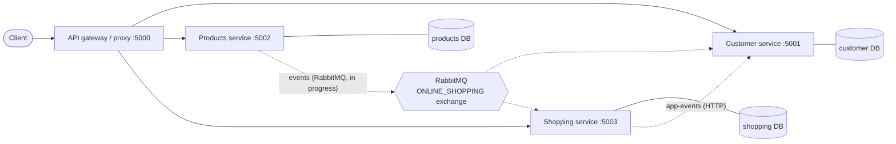

# Grocery Shopping — Microservices Backend

An online grocery shopping backend split into three independent **Node.js + TypeScript** services. Each service owns its own MongoDB database and exposes a REST API, and the services keep each other in sync through events.

> **Status:** work in progress. The services and their REST APIs work; moving all inter-service events onto RabbitMQ is under way (see [Roadmap](#roadmap)).

## Architecture



| Service | Port | Responsibility | Data it owns |
|---|---|---|---|
| **customer** | 5001 | Sign-up/login (JWT), profile, addresses, wishlist, customer's cart and order history | Customer, Address |
| **products** | 5002 | Product catalogue, categories, wishlist/cart actions that emit events | Product |
| **shopping** | 5003 | Cart and order placement | Cart, Order |

Each service follows the same layered structure:

```
src/
├── api/            # Express routes + /app-events endpoint + auth middleware
├── services/       # Business logic and event handling (SubscribeEvents)
├── database/
│   ├── models/     # Mongoose schemas
│   └── repository/ # Data access layer
├── dto/            # Request/response types
├── utils/          # JWT + password helpers, message broker, error classes
└── config/         # Environment-based configuration
```

### How the services stay in sync

The services never read each other's databases. When something changes in one service, it sends an event that the others apply to their own copy of the data:

- `ADD_TO_WISHLIST`, `REMOVE_FROM_WISHLIST` → customer
- `ADD_TO_CART`, `REMOVE_FROM_CART` → customer and shopping
- `CREATE_ORDER` → customer (order history)

Each service accepts events on `POST /app-events` and routes them in its `SubscribeEvents` handler. The products service also connects to RabbitMQ (`amqplib`) and declares a `direct` exchange (`ONLINE_SHOPPING`) with per-service binding keys, so events can be delivered through the broker instead of over HTTP.

## API overview

All protected routes need an `Authorization: Bearer <token>` header (token from `/login`).

**Customer service**
| Method | Route | Auth | Description |
|---|---|---|---|
| POST | `/signup` | | Register a customer |
| POST | `/login` | | Log in and receive a JWT |
| POST | `/address` | ✓ | Add a delivery address |
| GET | `/profile` | ✓ | Customer profile |
| GET | `/shopping-details` | ✓ | Cart and orders |
| GET | `/wishlist` | ✓ | Wishlist |

**Products service**
| Method | Route | Auth | Description |
|---|---|---|---|
| POST | `/product/create` | | Create a product |
| GET | `/` | | List products and categories |
| GET | `/category/:type` | | Products by category |
| GET | `/:id` | | Product details |
| POST | `/ids` | | Fetch several products by ID |
| PUT / DELETE | `/wishlist`, `/wishlist/:id` | ✓ | Add to / remove from wishlist |
| PUT / DELETE | `/cart`, `/cart/:id` | ✓ | Add to / remove from cart |

**Shopping service**
| Method | Route | Auth | Description |
|---|---|---|---|
| POST | `/order` | ✓ | Place an order from the cart |
| GET | `/orders` | ✓ | Order history |
| GET | `/cart` | ✓ | Current cart |

## Tech stack

- **Runtime:** Node.js, TypeScript, Express
- **Data:** MongoDB with Mongoose (one database per service)
- **Messaging:** RabbitMQ via `amqplib`; HTTP events via `axios`
- **Auth:** JWT (`jsonwebtoken`), password hashing with `bcrypt`
- **Validation & logging:** `class-validator` / `class-transformer`, `winston`

## Running locally

**Prerequisites:** Node.js 20+, MongoDB (local or Atlas), and RabbitMQ for the products service:

```bash
docker run -d --name rabbitmq -p 5672:5672 -p 15672:15672 rabbitmq:3-management
```

Then, for each service (`customer`, `products`, `shopping`):

```bash
cd customer
cp .env.example .env    # fill in the values below
npm install             # also compiles TypeScript to dist/
npm run dev             # watch mode with ts-node
```

### Environment variables

| Variable | Used by | Description |
|---|---|---|
| `PORT` | all | Defaults: customer 5001, products 5002, shopping 5003 |
| `MONGODB_URI` | all | MongoDB connection string. Use a separate database per service. |
| `APP_SECRET` | all | JWT signing secret. Must be the **same** value in every service. |
| `MESSAGE_BROKER_URL` | products | RabbitMQ URL, e.g. `amqp://localhost` |

Generate a secret with `openssl rand -base64 32`.

## Roadmap

- [ ] Publish all events through RabbitMQ and drop the HTTP `app-events` calls
- [ ] Add the API gateway service to this repository (shopping → customer events currently expect a proxy on `:5000`)
- [ ] Docker Compose for the whole stack
- [ ] Tests for the service and repository layers
